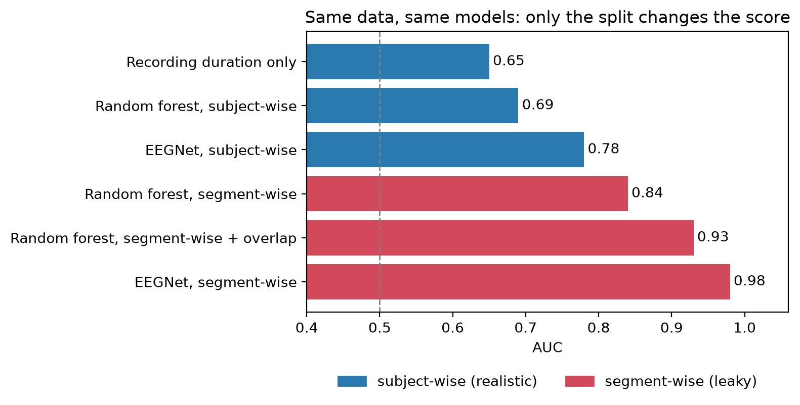

# Subject leakage, duration confounding and the blind spot of SHAP in EEG-based ADHD classification

Published EEG studies routinely report 95–99% accuracy for separating children with
ADHD from controls. This repository asks a simpler question: **do those numbers survive
an honest, subject-wise evaluation?** When every window from a child is kept on one side
of the split, accuracy collapses to a level barely above a baseline that only knows how
long each recording is — and the signal that remains looks like ordinary resting EEG, not
muscle or eye artifact. We also show that SHAP, a popular explainability tool, cannot tell
the leaky model from the honest one, even though the two rely on their features very
differently. Every number below is taken directly from the committed notebook outputs.

## The leakage ladder



**Figure.** Classification AUC rises as the evaluation gets more optimistic, not as the
model gets better. An honest **subject-wise** split (no child in both train and test) sits
near the recording-duration baseline at **AUC ≈ 0.64**. Switching to a **segment-wise**
split — where 4-second windows from the same child land in both train and test — inflates
the same random forest to **AUC ≈ 0.88**, and adding **overlapping** windows pushes it to
**AUC ≈ 0.93**. The gap between the subject-level and segment-level bars is pure leakage,
not diagnostic signal.

## Dataset

EEG recordings of children with ADHD and controls, from **IEEE DataPort**
(DOI [10.21227/rzfh-zn36](https://doi.org/10.21227/rzfh-zn36)): **61 ADHD + 60 control**
participants, ages 7–12, **19 channels** (10–20 montage), **128 Hz**.

The data is **not included in this repository** and must never be committed. To reproduce:

1. Download the `.mat` files from the DataPort record above (free IEEE account required).
2. Place them so that the two groups sit in their own folders:

   ```
   C:\data\eeg\adhd\ADHD\*.mat
   C:\data\eeg\adhd\Control\*.mat
   ```

3. If you keep the data elsewhere, edit the single `ROOT` path at the top of
   [`src/load.py`](src/load.py).

Each `.mat` file holds one participant as a `samples × 19` array in microvolts.

## Key results

- **Recording-duration baseline.** A classifier given only *how many seconds* each child
  was recorded already reaches **AUC 0.65**. ADHD recordings are simply longer on average
  (≈155 s vs ≈125 s), so duration is a confound any honest evaluation has to beat.

- **Segment-wise vs subject-wise (random forest on band-power features).** The same model
  scores **AUC 0.88** with a segment-wise split but only **AUC 0.64** subject-wise — i.e.
  no better than the duration baseline once leakage is removed.

- **Why the leaky score is so high: identity, not disorder.** A probe trained to recognise
  *which child* a window came from reaches **70% accuracy** (chance ≈ 0.8%). Segment-wise
  models can win just by memorising individuals.

- **Brain, not muscle (ablations).** Dropping the eye/muscle-prone edge channels (Fp1, Fp2,
  F7, F8, T7, T8) does **not** hurt the honest classifier (AUC 0.69 → 0.71), and an
  EMG-only feature set scores just **0.65**. Relative **alpha** power carries most of the
  signal (alpha-only, inner channels: 0.69) more than theta (0.65), and alpha is elevated
  in ADHD across central and posterior sites. The remaining signal is ordinary resting EEG.

- **A deep network does not rescue it.** EEGNet, evaluated subject-wise, reaches
  **subject-level AUC 0.78 ± 0.03** on all 19 channels and **0.75 ± 0.04** after removing
  the edge channels — better than the random forest, but a long way from the published
  95–99% and still reliant on genuine EEG rather than artifact.

- **SHAP's blind spot.** The SHAP feature rankings of the leaky and the honest model are
  **nearly identical (Spearman ρ = 0.975)** — SHAP cannot see the leak. Permutation
  importance tells a different story: the leaky model's predictions depend on its features
  **3.5 ± 0.8× more** than the honest model's (mean over 5 seeds). Attribution similarity
  does not imply the models are doing the same thing.

## Notebook guide

| Notebook | What it does |
|----------|--------------|
| [`00_check_data`](notebooks/00_check_data.ipynb) | Sanity-check raw recordings: channel count, montage, spectra, amplitude ranges. |
| [`01_dataset_overview`](notebooks/01_dataset_overview.ipynb) | Participant counts, recording durations, and the duration-only baseline (AUC 0.65). |
| [`02_features`](notebooks/02_features.ipynb) | Band-power and theta/beta-ratio features; group statistics and simple baselines. |
| [`03_paper_vs_honest`](notebooks/03_paper_vs_honest.ipynb) | Random forest: segment-wise (0.88) vs subject-wise (0.64), plus the subject-identity probe (0.70). |
| [`04_robustness_checks`](notebooks/04_robustness_checks.ipynb) | Equal-length control, duration confound, EMG/EOG checks, alpha topography. |
| [`05_brain_or_muscle`](notebooks/05_brain_or_muscle.ipynb) | Channel/band ablations: is it brain signal or artifact? |
| [`06_shap`](notebooks/06_shap.ipynb) | SHAP (ρ = 0.975) vs permutation importance (3.5× gap): the explainability blind spot. |
| [`07_overlap`](notebooks/07_overlap.ipynb) | Overlapping windows inflate the leaky score further (AUC 0.93). |
| [`08_eegnet`](notebooks/08_eegnet.ipynb) | EEGNet under a subject-wise split, with and without edge channels. |

## Limitations

- **State vs trait.** A single resting session captures brain *state*; it cannot separate a
  stable ADHD trait from momentary arousal, drowsiness or task compliance.
- **Medication.** Medication status and timing are not controlled here and can shift
  resting EEG (notably alpha and theta).
- **Multiple comparisons.** Per-channel and per-band tests are reported without formal
  correction; individual p-values should be read as descriptive, not confirmatory.
- **Single dataset.** All results come from one cohort on one acquisition system. The
  leakage effect is expected to generalise; the exact AUCs will not.

## How to reproduce

- **Environment:** conda env `medimg`, **CPU only**, Windows.
- Install the data as described under *Dataset* (outside the repo).
- Open each notebook in order (`00` → `08`) and **Restart Kernel → Run All**. The notebooks
  always split by **subject**, never by window; windows from one participant are never
  shared between train and test.

## Key takeaways (author)

> TODO — author's summary of what to conclude from these experiments.
